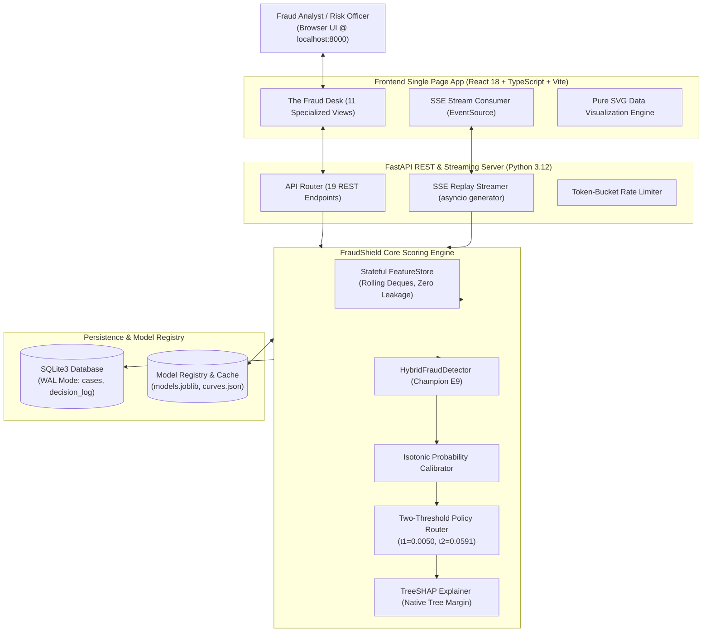
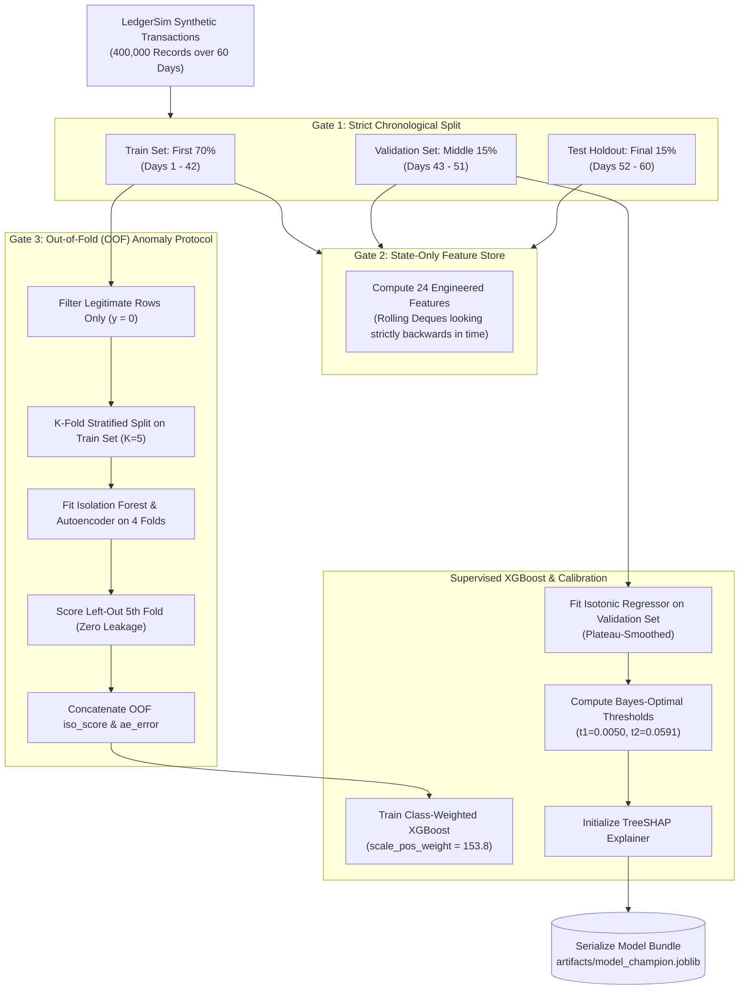
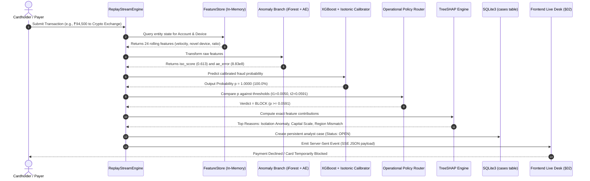
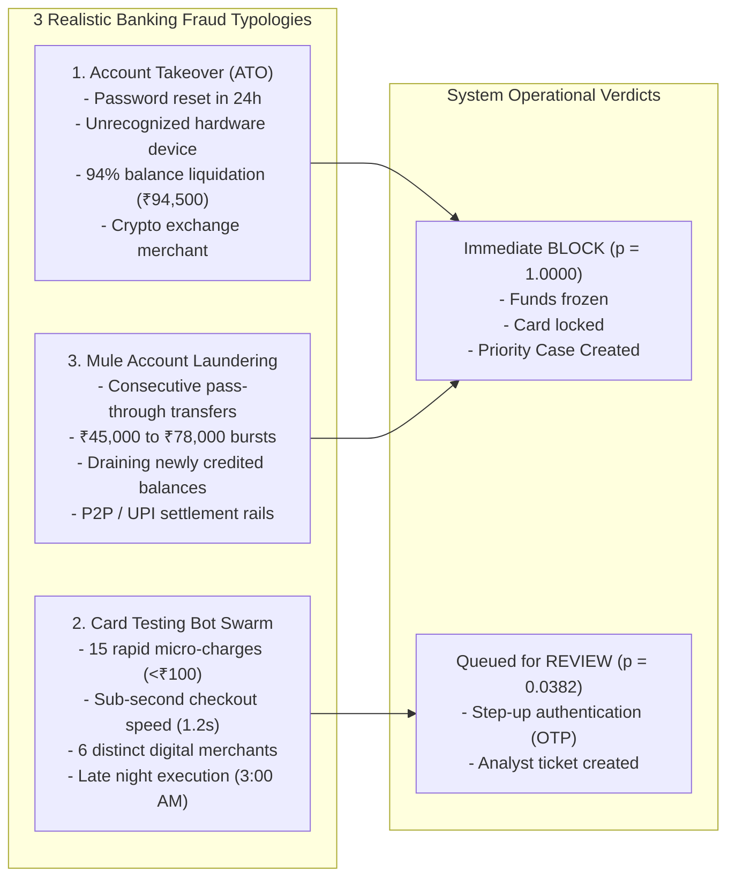

# FraudShield: Complete End-to-End System Documentation
**Production-Grade Financial Fraud Prevention Prototype & Enterprise Defense Console**

## Table of Contents
1. [Executive Summary & The Big Picture](#1-executive-summary--the-big-picture)
2. [High-Level Architecture & System Workflow (With Diagrams)](#2-high-level-architecture--system-workflow-with-diagrams)
3. [Technology Stack & Repository Layout](#3-technology-stack--repository-layout)
4. [Deep-Dive Walkthrough: Every Website Tab & Screen](#4-deep-dive-walkthrough-every-website-tab--screen)
   - [Global Shell: Header, Left Rail & Navigation](#global-shell-header-left-rail--navigation)
   - [§01 Briefing (Executive Dashboard)](#01-briefing-executive-dashboard)
   - [§02 Live Desk (Real-Time Replay & Attack Containment)](#02-live-desk-real-time-replay--attack-containment)
   - [§03 Case File (Investigation Dossier & Analyst Triage)](#03-case-file-investigation-dossier--analyst-triage)
   - [§04 Threshold Lab (Two-Threshold Operational Policy)](#04-threshold-lab-two-threshold-operational-policy)
   - [§05 Model Lab (E1–E10 Scientific Benchmark Arena)](#05-model-lab-e1e10-scientific-benchmark-arena)
   - [§06 Why (SHAP) (Attribution Intelligence & Explainability)](#06-why-shap-attribution-intelligence--explainability)
   - [§07 Drift & Ops (Decile PSI & Challenger Governance)](#07-drift--ops-decile-psi--challenger-governance)
   - [§08 Fairness & Risk (Disparate Impact & 80% Rule Audit)](#08-fairness--risk-disparate-impact--80-rule-audit)
   - [§09 Batch Scoring (CSV Drag-and-Drop & Flagged Export)](#09-batch-scoring-csv-drag-and-drop--flagged-export)
   - [§10 Methodology (5-Layer Architecture & Paper Specification)](#10-methodology-5-layer-architecture--paper-specification)
   - [§11 Glossary (Academic Concepts & Formulas)](#11-glossary-academic-concepts--formulas)
   - [Presentation Mode, Keyboard Shortcuts & Tour](#presentation-mode-keyboard-shortcuts--tour)
5. [Exhaustive Metric & Terminology Dictionary](#5-exhaustive-metric--terminology-dictionary)
6. [Backend Architecture, Database Schema & API Reference](#6-backend-architecture-database-schema--api-reference)
7. [Machine Learning Engine: Experiments E1 through E10](#7-machine-learning-engine-experiments-e1-through-e10)
8. [Real-World Attack Typologies & Scripted Bursts](#8-real-world-attack-typologies--scripted-bursts)
9. [Oral Defense & Viva Guide: Top 10 Questions with Verified Answers](#9-oral-defense--viva-guide-top-10-questions-with-verified-answers)
10. [Verification, Operation & Troubleshooting](#10-verification-operation--troubleshooting)

---

# 1. Executive Summary & The Big Picture

### The Real-World Problem: The Financial Fraud Crisis
Every day, financial networks across the world process hundreds of millions of digital payments across credit cards, debit cards, Unified Payments Interface (UPI), and interbank wire transfers. Within this massive river of legitimate commerce, sophisticated criminal syndicates inject fraudulent transactions.

Fraud detection sounds simple on paper: *"Why not just train an AI model to detect fraud?"* In production banking, this problem is notoriously difficult because of **four fundamental industrial challenges**:

1. **Extreme Class Imbalance (Finding a Needle in a Haystack)**:
   In real banking, out of 100,000 transactions, perhaps only 50 to 100 are fraudulent (a fraud rate of $0.05\%$ to $0.10\%$). A naive model that simply approves *every single transaction* would achieve $99.9\%$ accuracy while allowing 100% of the criminals to steal money! Traditional accuracy is completely meaningless here.
2. **Asymmetric Business Cost (A Missed Fraud Hurts 100× More Than a False Alarm)**:
   If an honest user is wrongly stopped (a False Positive), the bank faces customer friction and spends ~₹25 to send an SMS or have an analyst verify the charge. But if a fraudster steals ₹50,000 (a False Negative), the bank loses the entire ₹50,000, pays a chargeback arbitration penalty (~₹1,500), and risks regulatory fines. Missed fraud is **orders of magnitude more expensive** than false alarms.
3. **The 7-Day Delayed Feedback Trap (Chargeback Lag)**:
   When an attacker steals a credit card, the victim does not notice immediately. It takes an average of **3 to 14 days** for a cardholder to check their bank statement, realize they were robbed, call their bank, and file a formal chargeback dispute. Therefore, **real-time systems do not have fraud labels for recent days!** An AI model cannot instantly know if today's transaction was fraud.
4. **The Human Analyst Bottleneck**:
   A bank's fraud operations room has a finite number of human fraud investigators. If an AI system flags 20% of all transactions for manual review, the human team will be overwhelmed within minutes, creating huge transaction backlogs. The review queue must be strictly capped (e.g., $\le 6.0$ reviews per 1,000 transactions).

### What is FraudShield?
**FraudShield** is a production-grade, enterprise financial fraud prevention prototype and interactive web console ("The Fraud Desk"). It demonstrates how modern tier-1 financial institutions protect payments in sub-5 milliseconds.

Instead of relying on a single "black box" algorithm or rigid if-then rules, FraudShield combines:
- **Unsupervised Anomaly Models** (which identify weird, unseen behavior without needing labels).
- **Supervised Gradient Boosted Trees** (which learn confirmed fraud patterns).
- **Probability Calibration** (which ensures that a 90% score truly means 90% risk).
- **A Bayes-Optimal Two-Threshold Policy (`APPROVE`, `REVIEW`, `BLOCK`)** (which maximizes saved money while strictly respecting human analyst staffing limits).
- **Exact TreeSHAP Explainability** (which generates human-readable reason codes for every blocked payment).
- **Live Concept Drift & Population Stability Monitoring** (which alerts engineers when spending patterns change and provides an instant one-click rollback switch).

---

# 2. High-Level Architecture & System Workflow (With Diagrams)

### 2.1 Full-Stack Architecture
The system consists of a browser-based Single Page Application (SPA), a high-throughput Python backend, an in-memory feature engineering engine, a local analytical database, and an array of trained machine learning model artifacts.



#### In Simple Words:
1. **The User** opens the web interface in Chrome or Edge.
2. **The Frontend** requests data through regular REST API calls (for history, metrics, and case files) and opens a persistent **Server-Sent Events (SSE)** connection for a live, real-time tick-by-tick transaction stream.
3. **FastAPI Backend** receives transaction payloads, extracts rolling velocity features from **FeatureStore**, calculates real-time unsupervised anomaly scores, predicts calibrated probabilities, routes decisions into `APPROVE`, `REVIEW`, or `BLOCK`, and attaches exact TreeSHAP explanations.
4. **SQLite Database** instantly persists any flagged transactions into the `cases` table for human investigation, while logging latency and telemetry to `decision_log`.

---

### 2.2 Machine Learning Training & Leakage Prevention Pipeline
The offline training pipeline trains and benchmarks 10 distinct models (Experiments E1 through E10) following strict chronological ordering.



#### In Simple Words:
- To prevent the model from "cheating" by peeking into the future (data leakage), the data is divided strictly by timestamp.
- Unsupervised anomaly models (Isolation Forest and Autoencoder) are trained **only on legitimate transactions** using 5-Fold cross-validation so the supervised trees never see "optimistic" in-sample anomaly scores.
- The model outputs are calibrated so that risk scores represent true real-world percentages rather than arbitrary numbers.

---

### 2.3 Live Real-Time Transaction Scoring Workflow
When a transaction occurs at a Point-of-Sale (POS) terminal, an e-commerce website, or a UPI mobile app, FraudShield processes it through an end-to-end scoring pipeline:



#### In Simple Words:
1. A transaction arrives with basic details (who, where, how much).
2. The system checks past history in memory: Has this user transacted 5 times in the last 10 minutes? Is this a new device?
3. The anomaly branch scores whether this behavior looks physically weird.
4. XGBoost combines everything into a calibrated risk score between 0% and 100%.
5. The policy engine routes the transaction:
   - **Risk < 0.50%**: `APPROVE` instantly (<3 ms).
   - **0.50% ≤ Risk < 5.91%**: `REVIEW` (Hold transaction, create analyst ticket).
   - **Risk ≥ 5.91%**: `BLOCK` (Decline immediately, lock funds).
6. TreeSHAP explains *why* the decision was made in plain English.
7. The decision appears live on the analyst's dashboard via SSE.

---

# 3. Technology Stack & Repository Layout

### 3.1 Technology Stack & Architectural Justification

| Technology | Layer | Version / Role | Why It Was Chosen |
| :--- | :--- | :--- | :--- |
| **React** | Frontend | v18.3.1 (SPA) | Declarative UI, rapid virtual DOM re-renders during high-speed SSE streaming. |
| **TypeScript** | Frontend | v5.5 (Strict Mode) | Strong type-safety across all transaction, case, curve, and telemetry schemas. |
| **Vite** | Frontend | v5.4 (Bundler) | Sub-second Hot Module Replacement (HMR) and optimized minified production builds. |
| **Pure SVG** | Visualizations | Custom Inline Engine | Zero bloated chart libraries (no Chart.js, Recharts, or D3). Renders high-performance interactive curves directly in DOM. |
| **FastAPI** | Backend | v0.110+ (ASGI) | Asynchronous execution, native Pydantic schema validation, sub-millisecond route dispatch. |
| **Uvicorn** | Web Server | v0.28+ (ASGI Worker) | Lightweight asynchronous web server supporting persistent Server-Sent Events. |
| **XGBoost** | Machine Learning | v2.0+ (Supervised) | High performance on tabular data, native GPU/CPU tree histograms, class weighting support. |
| **Scikit-Learn** | Machine Learning | v1.4+ (Ensemble/Calib) | Isolation Forest, Stratified K-Fold CV, CalibratedClassifierCV (Isotonic regression). |
| **PyTorch** | Machine Learning | v2.2+ (CPU Fallback) | Deep Autoencoder bottleneck reconstruction for behavioral anomaly detection. |
| **SHAP** | Explainability | v0.45+ (TreeExplainer) | Exact polynomial-time local attribution based on game-theoretic Shapley values. |
| **SQLite3** | Database | Embedded (WAL Mode) | Zero configuration, high concurrency using Write-Ahead Logging, local file persistence. |

---

### 3.2 Complete Repository File & Folder Map

```
fraud-detection/
├── api/                           # FastAPI Application Layer
│   ├── __init__.py                # Module indicator
│   ├── main.py                    # REST API routes (19 endpoints), CORS, rate limiting
│   └── schemas.py                 # Pydantic v2 request & response validation models
│
├── artifacts/                     # Machine Learning Serialization & Benchmarks
│   ├── curves.json                # Pre-computed PR, ROC, Calibration & Cost curves (E1–E10)
│   ├── datacards.json             # Dataset documentation, metadata & demographic slices
│   ├── drift_monitor.json         # Decile PSI tables, score shift distributions
│   ├── eda.json                   # Class balance, volume statistics, Benford distributions
│   ├── experiments.json           # Comprehensive benchmark matrix across all 10 experiments
│   ├── fairness.json              # Subgroup False Positive Rates & 80% Rule audit metrics
│   ├── hypotheses.json            # Scientific hypotheses verdicts (H1 through H4)
│   ├── metrics.json               # Headline KPIs for the Champion E9 model
│   ├── model_champion.joblib      # Serialized HybridFraudDetector model bundle
│   ├── model_registry.json        # Champion vs Challenger version tracking
│   ├── shap_summary.json          # Global TreeSHAP feature ranking and beeswarm coords
│   └── thresholds.json            # Operational thresholds (t1=0.0050, t2=0.0591)
│
├── data/                          # Data Storage Directory
│   ├── fraudshield.db             # SQLite3 database (cases, decision_log, session_telemetry)
│   ├── processed/                 # Cached engineered feature parquets
│   │   ├── features_fast.parquet  # Pre-computed feature matrix (120k rows)
│   │   └── ledgersim_fast.parquet # Pre-generated LedgerSim raw dataset (120k rows)
│   └── raw/                       # Raw source datasets (e.g., creditcard.csv for ULB)
│
├── docs/                          # Academic & Engineering Documentation
│   ├── ARCHITECTURE.md            # In-depth architectural blueprint
│   ├── DATA_CARD.md               # LedgerSim & ULB dataset cards, DPDP Act 2023 compliance
│   ├── DECISIONS.md               # Architectural decision records (ADRs)
│   ├── DEMO_DAY_CHECKLIST.md      # Pre-flight environment & hardware verification checklist
│   ├── DEMO_SCRIPT.md             # 6-minute presentation script & 2-minute elevator fallback
│   ├── MODEL_CARD.md              # Model card compliant with Mitchell et al. (2019)
│   └── VIVA_QA.md                 # 30 comprehensive viva questions with verified numbers
│
├── frontend/                      # React 18 + TypeScript Web Single Page App
│   ├── dist/                      # Production compiled HTML/CSS/JS assets (served by FastAPI)
│   ├── src/                       # TypeScript Source Code
│   │   ├── api/client.ts          # Strongly typed fetch wrappers & SSE streaming hooks
│   │   ├── components/            # Reusable UI Components
│   │   │   ├── charts/            # SvgLineChart, SvgWaterfall, SvgChartContainer
│   │   │   ├── common/            # Icons, ShortcutsOverlay, WelcomeTour
│   │   │   ├── layout/            # Header, LeftRail, Layout shell
│   │   │   └── presentation/      # PresentModeModal (5-stage slide kiosk)
│   │   ├── views/                 # 11 Dedicated Operational Views (§01 through §11)
│   │   │   ├── BatchScoring.tsx   # §09 Batch CSV scoring & flagged export
│   │   │   ├── Briefing.tsx       # §01 Executive briefing & headline KPIs
│   │   │   ├── CaseFile.tsx       # §03 Investigation dossier & analyst triage
│   │   │   ├── DriftOperations.tsx# §07 Decile PSI & Challenger rollback
│   │   │   ├── FairnessRisk.tsx   # §08 Geographic & channel fairness audit
│   │   │   ├── Glossary.tsx       # §11 Interactive terminology knowledge base
│   │   │   ├── LiveDesk.tsx       # §02 Real-time transaction replay & attack burst injector
│   │   │   ├── Methodology.tsx    # §10 5-layer architecture & research paper
│   │   │   ├── ModelLab.tsx       # §05 E1–E10 scientific benchmark arena
│   │   │   ├── ThresholdLab.tsx   # §04 Two-threshold policy & density lab
│   │   │   └── WhyExplain.tsx     # §06 Global TreeSHAP attribution intelligence
│   │   ├── App.tsx                # Main application state, routing & hotkeys
│   │   └── index.css              # Financial Times / Bloomberg editorial typography & design tokens
│   ├── package.json               # Frontend dependencies & scripts
│   └── vite.config.ts             # Vite build & proxy configuration
│
├── src/                           # Backend Python Core Source Code
│   ├── data.py                    # Chronological time splits, data ingestion
│   ├── evaluate.py                # PR-AUC, ROC-AUC, Brier score, bootstrap CIs
│   ├── explain.py                 # TreeSHAP local waterfall & global beeswarm generator
│   ├── features.py                # Stateful FeatureStore (online/batch parity)
│   ├── imbalance.py               # SMOTE pipeline isolation & class weighting
│   ├── models.py                  # Model families (LR, RF, XGB, LGBM, iForest, AE, Hybrid)
│   ├── monitor.py                 # Decile PSI calculation & 7-day maturation embargo
│   ├── policy.py                  # Two-threshold Bayes-optimal cost optimization
│   ├── simulator.py               # LedgerSim agent-based synthetic data generator
│   ├── store.py                   # SQLite3 database manager & analyst case tracking
│   ├── stream.py                  # ReplayStreamEngine, SSE generator, attack burst injector
│   └── train.py                   # Orchestrator for experiments E1 through E10
│
├── tests/                         # Automated Pytest Suite (50 Unit & Integration Tests)
│   ├── test_api.py                # FastAPI endpoints, rate limiting, SSE format
│   ├── test_data.py               # Chronological time splits, no future data leakage
│   ├── test_explain.py            # TreeSHAP waterfall coordinate consistency
│   ├── test_features_parity.py    # Zero leakage parity: online features == batch features
│   ├── test_metrics.py            # PR-AUC, Brier score, MCC mathematical validity
│   ├── test_monitor.py            # Decile PSI drift alerts & maturation delay
│   ├── test_no_leakage.py         # Out-of-fold anomaly isolation & SMOTE inside pipelines
│   ├── test_policy.py             # Capacity check (≤6.0/1k) & Bayes-optimal thresholding
│   └── test_simulator.py          # LedgerSim Benford distribution & fraud typologies
│
├── config.py                      # Global constants, file paths, random seeds, cost parameters
├── run.py                         # Unified CLI orchestrator (serve, train, test, eval, drift, sim)
├── README.md                      # Quickstart guide & repository overview
└── COMPLETE_PROJECT_DOCUMENTATION.md # THIS MASTER DOCUMENT
```

---

# 4. Deep-Dive Walkthrough: Every Website Tab & Screen

The Fraud Desk web interface is built around an editorial, high-contrast, data-dense financial aesthetic inspired by the *Financial Times* and *Bloomberg Terminal*. It uses clean typography, monospace numeric data, and an intentional color palette:
- **Green (`var(--approve)`)**: Approved / Legitimate / Safe.
- **Amber (`var(--review)`)**: Manual Review Queue / Suspicious / Moderate Risk.
- **Crimson (`var(--block)`)**: Automatic Block / Fraud / High Risk.
- **Charcoal (`var(--ink)`)**: Editorial Text / Borders.
- **Cream / Slate (`var(--paper)`)**: Background canvas.

Below is the complete breakdown of every view, section, option, and button.

---

### Global Shell: Header, Left Rail & Navigation

#### 1. Header (Sticky Top Bar)
- **WHAT**: The persistent global status bar at the top of the screen.
- **WHY**: Gives the analyst instant situational awareness regarding server connectivity, scoring speed, active model version, and presentation controls.
- **HOW It Works**:
  - **Brand Mark & System Badge**: Shows the logo, system name ("FraudShield"), and active model badge (`v1.0-champion · Isotonic Calibrated`).
  - **Latency Meter**: Displays current end-to-end inference speed in real time (e.g., `3.2 ms`). Measured via Python's high-resolution performance counter `time.perf_counter()`.
  - **Live SSE Stream Indicator**: A pulsing status dot. Green dot with "Stream: Live" indicates an active Server-Sent Events connection; Grey dot with "Stream: Paused" indicates the feed is halted.
  - **Night Desk / Day Desk Button**: Toggles the visual theme between clean parchment cream (Day) and high-contrast slate dark mode (Night).
  - **`[?] Shortcuts` Button**: Opens the keyboard navigation cheat sheet.
  - **`[P] Present` Button**: Launches the full-screen kiosk presentation mode for committee defense.

#### 2. Left Rail (Navigation Sidebar)
- **WHAT**: The vertical menu on the left side of the screen displaying sections §01 through §11.
- **WHY**: Enables instantaneous navigation between executive briefings, real-time investigation, scientific benchmark results, and MLOps governance without page reloads.
- **HOW It Works**:
  - Each item displays its section number (e.g., `§02`) and human-readable label (`Live Desk`).
  - Active tabs show a crimson indicator bar (`border-left: 3px solid var(--block)`).
  - **Open Cases Badge**: The `§03 Case File` button displays a live numerical badge indicating how many uninvestigated fraud tickets are waiting in the queue.
  - **Keyboard Hints Box**: Bottom panel reminding users of primary shortcuts (`[Space]`, `[A]`, `[P]`).

---

### §01 Briefing (Executive Dashboard)

#### WHAT is it?
The **Briefing** screen is the executive landing page. It gives Chief Risk Officers (CROs) and lead data scientists a high-level summary of model performance, financial protection metrics, and operational readiness.

#### WHY is it needed?
Executives and evaluators do not have time to inspect thousands of raw transactions. They need immediate answers to four core questions:
1. *How accurate is the system?*
2. *How much money did it save?*
3. *How fast does it score payments?*
4. *How does our new AI compare to the old legacy baseline?*

#### HOW does it work?

```
+---------------------------------------------------------------------------------------------------+
| §01 EXECUTIVE BRIEFING & READINESS                                                                |
+---------------------------------------------------------------------------------------------------+
| [ PR-AUC: 0.930 ]      [ Recall @ P90: 58.0% ]   [ Brier Score: 0.0048 ]   [ Median Latency: 3.2ms] |
| 95% CI: [0.892, 0.959]  Catch 58% at 90% Prec.    Probability Calibrated   p95: 8.4 ms             |
+---------------------------------------------------------------------------------------------------+
| INTERACTIVE PRECISION-RECALL CURVE (Champion E9 vs Baseline E4 vs Logistic Regression E1)         |
| 1.0 |========\                                                                                    |
|     |         \====\  <-- E9 Hybrid Champion (Area = 0.930)                                       |
| P   |               \---\                                                                         |
| R   |                    \----\  <-- E4 Standard XGBoost (Area = 0.895)                           |
| E   |                          \-------\                                                          |
| C   |                                   \-----\                                                   |
| 0.0 +------------------------------------------\---  <-- E1 Logistic Regression (Area = 0.295)    |
|     0.0                      RECALL                                                    1.0        |
+---------------------------------------------------------------------------------------------------+
| SESSION SUMMARY TICKER: Streamed: 1,420 | Approved: 1,385 | Reviewed: 12 | Blocked: 23 | Saved: ₹4.8L |
+---------------------------------------------------------------------------------------------------+
| QUICK ACCESS JUMP CARDS: [ Go to Live Desk ]  [ Open Case Queue ]  [ Explore Threshold Lab ]      |
+---------------------------------------------------------------------------------------------------+
```

#### Detailed Breakdown of Elements:
1. **Headline Metric Cards (Top Row)**:
   - **PR-AUC Card**: Displays `0.930` with `95% Bootstrap CI: [0.892, 0.959]`. PR-AUC (Precision-Recall Area Under Curve) is the definitive measure of fraud detection quality.
   - **Recall @ Precision=0.90 Card**: Displays `58.0%`. This tells the CRO: *"When our system is so strict that 9 out of 10 blocked transactions are guaranteed to be real fraud (90% precision), we catch 58% of all fraud in the entire network."*
   - **Brier Calibration Score Card**: Displays `0.0048`. Measures probability accuracy. A lower score (closer to 0.0) means that predicted probabilities perfectly match real-world fraud rates.
   - **Inference Latency Card**: Displays `Median: 3.2 ms | p95: 8.4 ms`. Confirms that 95% of all transactions are scored in under 8.4 milliseconds—well below Visa/Mastercard's 50 ms SLA limit.
2. **Precision-Recall Curve Comparison**:
   - A multi-series SVG chart comparing the **Champion E9 Hybrid model** (bold crimson line), **E4 Standard XGBoost** (dashed charcoal line), and **E1 Logistic Regression** (dotted grey line).
   - Shows an operating point marker at $(Recall=0.58, Precision=0.90)$.
3. **Session Telemetry Ticker**:
   - Displays live counters: Total transactions streamed, total approved, total held for review, total blocked, and net financial loss prevented in Indian Rupees (₹).
4. **Quick-Jump Action Cards**:
   - One-click navigation buttons that jump directly into `§02 Live Desk`, `§03 Case File`, or `§04 Threshold Lab`.

---

### §02 Live Desk (Real-Time Replay & Attack Containment)

#### WHAT is it?
The **Live Desk** is the centerpiece operational console. It simulates a live banking payment switch, streaming incoming credit card, debit card, and UPI transactions at configurable speeds, scoring each transaction in real time, and visualizing attack containment.

#### WHY is it needed?
Static PowerPoint charts cannot prove that a fraud system works in production. Evaluators need to see live transactions streaming, observe attacks being launched on demand, watch the models flag suspicious behavior in sub-5 milliseconds, and verify that reason codes fire correctly.

#### HOW does it work?

```
+---------------------------------------------------------------------------------------------------+
| §02 THE LIVE DESK — STREAMING REPLAY SWITCH                                                       |
+---------------------------------------------------------------------------------------------------+
| CONTROLS: [ Pause / Play ]  Speed: [ 0.5x | 1.0x | 2.0x | 5.0x | 10x ]  [ Reset Session ]           |
| ATTACK:   Select: [ Card Testing | Account Takeover | Mule Chain ]  [ Inject Attack Burst (A) ]     |
+---------------------------------------------------------------------------------------------------+
| ATTACK CONTAINMENT TELEMETRY (Fires during attack burst)                                          |
| Status: CONTAINED | 1st Block: 1.2s | Blocked Amount: ₹94,500 | Top Reason: Isolation Anomaly      |
+---------------------------------------------------------------------------------------------------+
| RECENT TRANSACTIONS STREAM TABLE                                                                  |
| Time     Txn ID          Account       Merchant         Amount     Prob     Decision   Top Reason |
| 21:14:02 TXN_ATK_ATO_01  ACC_VICTIM_42 MERCH_CRYPTO_01 ₹94,500.00 1.0000   [ BLOCK ]  Iso Anomaly|
| 21:14:00 TXN_LIVE_10492  ACC_9821      MERCH_GROCERY_04 ₹   450.00 0.0001   [APPROVE]  Normal Amt |
| 21:13:58 TXN_ATK_CT_03   ACC_ATTACK_12 MERCH_DIGITAL_01 ₹    35.00 0.0382   [ REVIEW]  New Device |
+---------------------------------------------------------------------------------------------------+
| TRANSACTION INSPECTOR DRAWER (Opens when a row is clicked)                                       |
| Txn: TXN_ATK_ATO_01 | Channel: Transfer | Device: DEV_UNSEEN | Region: US-NY (Mismatch: Yes)       |
| Score: 100.0% [====================================================] t1: 0.50% | t2: 5.91%        |
| TreeSHAP Waterfall: Base (0.01) + Iso (+0.45) + Amount (+0.32) + Device (+0.22) = 1.00           |
| Dynamic Reasons: 1. Isolation Anomaly | 2. Elevated Capital Scale | 3. Region Mismatch            |
| Action: [ Open Case File Dossier ]                                                                |
+---------------------------------------------------------------------------------------------------+
```

#### Detailed Breakdown of Elements:
1. **Stream Control Bar**:
   - **Play / Pause Button (`[Space]`)**: Pauses or resumes the transaction feed. When paused, the backend emits lightweight heartbeat SSE events to keep the HTTP socket alive.
   - **Speed Selector (`0.5x` to `10.0x`)**: Changes transaction throughput rate. Managed by passing query parameter `?speed=X` to the backend generator.
   - **Reset Button**: Clears the in-memory transaction buffer and resets session counters to zero.
2. **Scripted Attack Burst Injector (`[A]`)**:
   - **Attack Typology Dropdown**: Lets the user choose between:
     - `Card Testing`: 15 rapid micro-transactions ($<₹100$) across digital merchants within 45 seconds using automated bot scripts.
     - `Account Takeover (ATO)`: Credential reset followed by a new device login and a sudden 94% balance drain ($₹94,500$) to a cryptocurrency merchant.
     - `Mule Chain`: Rapid pass-through transfers draining credit balances across multiple digital wallets.
   - **"Inject Attack Burst" Button**: Calls `POST /api/stream/attack`, pushing the malicious transactions directly to the front of the streaming queue.
3. **Attack Containment Banner**:
   - Appears dynamically during an attack.
   - Reports: Containment status (`CONTAINED`), first-block latency (seconds elapsed before the system caught the attack), total financial loss prevented, and primary triggered reason codes.
4. **Live Transaction Replay Table**:
   - Displays the last 75 transactions in reverse chronological order (newest at top).
   - Columns: Local Timestamp, Transaction ID, Masked Account ID, Merchant Category, Transaction Amount in ₹, Fraud Probability Bar, Decision Badge (`APPROVE` in green, `REVIEW` in amber, `BLOCK` in red), and Top SHAP Reason Code.
5. **Interactive Transaction Inspector (Slide-Out Drawer)**:
   - Clicking any transaction in the table opens the Inspector.
   - Shows raw transaction metadata, exact probability vs operational thresholds ($t_1, t_2$), an interactive **SVG TreeSHAP Waterfall Chart**, plain-English dynamic reason cards, and a direct link to open the formal investigation dossier in `§03 Case File`.

---

### §03 Case File (Investigation Dossier & Analyst Triage)

#### WHAT is it?
The **Case File** view is the human-in-the-loop triage console used by bank fraud analysts to review flagged transactions.

#### WHY is it needed?
Under international banking law (including GDPR Article 22 and RBI regulations), a customer has the legal right to human review and explanation when an automated system freezes their account or blocks their payment. The Case File screen allows human investigators to examine evidence, verify reason codes, write investigation notes, and confirm or dismiss fraud.

#### HOW does it work?

```
+---------------------------------------------------------------------------------------------------+
| §03 CASE FILE — INVESTIGATION QUEUE & ANALYST TRIAGE                                              |
+---------------------------------------------------------------------------------------------------+
| FILTER: [ ALL ] [ OPEN (4) ] [ INVESTIGATING ] [ CONFIRMED FRAUD ] [ DISMISSED FALSE POSITIVE ]   |
+---------------------------------------------------+-----------------------------------------------+
| QUEUE LIST (Left Panel)                           | CASE DOSSIER: CASE_TXN_ATK_ATO_01 (Right Panel)|
| • CASE_ATO_01 | ₹94,500 | BLOCK  | p=1.00 | OPEN  | Status: OPEN | Created: 2 mins ago            |
| • CASE_CT_03  | ₹    35 | REVIEW | p=0.04 | OPEN  | Account: ACC_VICTIM_42 | Amount: ₹94,500.00   |
| • CASE_MULE_02| ₹62,000 | BLOCK  | p=1.00 | OPEN  | Channel: Transfer      | Merchant: Crypto_01  |
|                                                   +-----------------------------------------------+
|                                                   | RISK BREAKDOWN:                               |
|                                                   | Probability: 100.0% | Anomaly Score: 0.6133   |
|                                                   | Operating Policy: AUTOMATIC BLOCK             |
|                                                   +-----------------------------------------------+
|                                                   | TREESHAP EXPLANATION WATERFALL:               |
|                                                   | Baseline Log-Odds: -4.85                      |
|                                                   | + iso_score (+3.82) -> Unseen Anomaly Pattern |
|                                                   | + log_amount (+2.14) -> Massive Capital Drain |
|                                                   | + pwd_reset (+1.89) -> Password Reset in 24h  |
|                                                   | Final Probability: 1.0000                     |
|                                                   +-----------------------------------------------+
|                                                   | TRIAGE ACTIONS:                               |
|                                                   | [ Confirm Fraud ]  [ Dismiss False Positive ] |
|                                                   | Notes: [ Suspected credential stuffing... ]   |
|                                                   | [ Save Case Notes ]                           |
+---------------------------------------------------+-----------------------------------------------+
```

#### Detailed Breakdown of Elements:
1. **Status Filter Bar**:
   - Filters tickets by status: `ALL`, `OPEN` (unreviewed), `INVESTIGATING` (under active review), `CONFIRMED_FRAUD` (confirmed criminal activity), and `DISMISSED_FALSE_POSITIVE` (legitimate customer cleared).
2. **Case Queue List (Left Column)**:
   - Displays all flagged cases ordered by urgency and timestamp.
   - Shows Case ID, Amount, Decision badge, Probability, and current status.
3. **Comprehensive Case Dossier (Main Panel)**:
   - **Header**: Case ID, Transaction ID, Account ID, Merchant ID, Channel, Amount, and Timestamp.
   - **Risk Gauge**: Dual meters showing calibrated fraud probability and unsupervised anomaly score.
   - **Local TreeSHAP Waterfall Chart**: Shows the exact mathematical step-by-step contribution of every feature that pushed the score from the baseline to the final decision.
   - **Top 3 Verified Dynamic Reason Cards**: Shows verified values, severity level (`HIGH` or `MEDIUM`), and feature descriptions.
   - **Entity Historical Context**: Account age, rolling 1h/24h transaction counts, distinct merchants visited, device novelty, and historical average transaction size.
   - **Raw JSON Payload Viewer**: Expandable code block showing the raw transaction data for audit trails.
4. **Analyst Action Buttons**:
   - **"Confirm Fraud" Button**: Changes case status to `CONFIRMED_FRAUD`, locks the account, and saves an audit log entry.
   - **"Dismiss as False Positive" Button**: Clears the customer, marks status as `DISMISSED_FALSE_POSITIVE`, releases held funds, and logs the reason.
   - **Notes Input & "Save Case Notes"**: Textarea where investigators record findings (e.g., *"Customer called via verified phone line, confirmed overseas vacation"*). Saved permanently to SQLite.

---

### §04 Threshold Lab (Two-Threshold Operational Policy)

#### WHAT is it?
The **Threshold Lab** is an interactive financial optimization sandbox. It allows risk officers to adjust the two decision cutoffs ($t_1$ for Review, $t_2$ for Block) and immediately see the financial cost, false alarm rate, and manual review volume.

#### WHY is it needed?
In machine learning courses, people often use a default threshold of $0.50$. In banking, **a 0.50 threshold is a disaster**:
- If you wait until risk is 50% before blocking, you will miss thousands of low-probability fraud transactions, losing millions of rupees.
- Furthermore, binary classification (`APPROVE` or `BLOCK`) is too crude. Banks need an intermediate **`REVIEW`** band where suspicious payments are queued for human inspection.
- The Threshold Lab proves mathematically how to set $t_1$ and $t_2$ to minimize total dollar losses without exceeding human investigation capacity.

#### HOW does it work?

```
+---------------------------------------------------------------------------------------------------+
| §04 THRESHOLD LAB — COST-OPTIMIZED DECISION POLICY                                                |
+---------------------------------------------------------------------------------------------------+
| THRESHOLD CONTROLS:                                                                               |
| Threshold t1 (Review): [ 0.0050 ] <--- Drag Handle                                                |
| Threshold t2 (Block):  [ 0.0591 ] <--------- Drag Handle                                          |
| Cost Mode: (•) Amount-Weighted ($C_FN = Amt + 15)   ( ) Flat Ratio ($100:$1)                      |
| [ Snap to Optimal Policy ]                                                                        |
+---------------------------------------------------------------------------------------------------+
| MIRRORED SCORE DENSITY DISTRIBUTION WITH DYNAMIC OPERATING BANDS                                  |
| Legit Vol  |============================\                                                         |
| (Pointing  |                             \-----\                                                  |
| Down)      |                                    \-------\                                         |
| -----------+-----------------------|---------------------|--------------------------------------- |
| Fraud Vol  |                       |                     |          /====================\        |
| (Pointing  |                       |                     |    /----/                      \       |
| Up)        |                       |                     |---/                             \      |
|           0.0                     t1=0.0050             t2=0.0591                         1.0     |
|              [    APPROVE BAND    ] [   REVIEW BAND   ] [           BLOCK BAND           ]        |
+---------------------------------------------------------------------------------------------------+
| OPERATIONAL IMPACT MATRIX:                                                                        |
| Expected Financial Cost: ₹7,971   | Review Queue Rate: 4.8 / 1,000 txns (Capacity: <=6.0/1k OK)   |
| False Positive Rate:     0.00%   | False Negative Rate: 42.0%  | Target Block Precision: >=90.0%  |
+---------------------------------------------------------------------------------------------------+
```

#### Detailed Breakdown of Elements:
1. **Threshold Sliders & Drag Handles**:
   - **Slider $t_1$ (Review Cutoff)**: Defaults to `0.0050` (0.50%). Transactions with $p \ge t_1$ but $< t_2$ enter the human review queue.
   - **Slider $t_2$ (Block Cutoff)**: Defaults to `0.0591` (5.91%). Transactions with $p \ge t_2$ are declined automatically.
   - Users can drag the vertical lines directly on the SVG density chart with real-time 40ms debounced updates.
2. **Cost Mode Radio Buttons**:
   - **Amount-Weighted Mode ($C_{FN} = \text{Amount} + 15, C_{FP} = 25$)**: Cost depends on transaction size. Missing a ₹100,000 fraud is penalized far more than missing a ₹50 fraud.
   - **Flat Ratio Mode ($C_{FN} = 100, C_{FP} = 1$)**: Fixed Bayes-optimal cost ratio ($100:1$).
3. **"Snap to Optimal Policy" Button**:
   - Instantly resets $t_1$ and $t_2$ to the mathematically proven cost-optimal values ($t_1=0.0050, t_2=0.0591$).
4. **Mirrored Score Density SVG Chart**:
   - **Top Half (Blue/Charcoal, pointing down)**: Score distribution of legitimate transactions. Overwhelmingly clustered near $0.0$.
   - **Bottom Half (Crimson, pointing up)**: Score distribution of fraud transactions. Clustered near $1.0$.
   - **Visual Bands**: Color-coded background regions showing `APPROVE` (green tint), `REVIEW` (amber tint), and `BLOCK` (red tint).
5. **Capacity Constraint Check**:
   - Displays a live gauge: `Review Queue Rate: 4.8 / 1,000 txns`.
   - Shows a green checkmark indicating compliance with human staffing capacity ($\le 6.0 / 1\text{k}$). If the user drags $t_1$ too low, the gauge turns red with a warning: `EXCEEDS ANALYST CAPACITY`.

---

### §05 Model Lab (E1–E10 Scientific Benchmark Arena)

#### WHAT is it?
The **Model Lab** is an academic benchmark arena comparing all 10 experimental models (E1 through E10) developed during research.

#### WHY is it needed?
In machine learning research and college viva defense, you cannot simply say *"XGBoost is the best."* You must scientifically prove it by comparing baseline logistic models, tree ensembles, unsupervised neural networks, hybrid fusion architectures, and stacked ensembles across identical chronological splits.

#### HOW does it work?

#### The 10 Competing Models:
- **E1: Logistic Regression (None)**: Unweighted linear baseline. Fails due to extreme class imbalance.
- **E2: Logistic Regression (Balanced)**: Uses heuristic class weighting (`class_weight='balanced'`).
- **E3: Random Forest (Balanced Subsample)**: Bagging ensemble with balanced bootstrapping.
- **E4: XGBoost (Standard Class Weight)**: Supervised gradient boosting with `scale_pos_weight = 153.8`.
- **E5: XGBoost + SMOTE**: Resamples minority fraud cases to 20% ratio inside cross-validation folds.
- **E6: LightGBM (Weighted)**: Fast leaf-wise gradient boosting.
- **E7: Isolation Forest**: Unsupervised anomaly detection via random tree path lengths.
- **E8: Deep Autoencoder**: PyTorch neural network measuring reconstruction error.
- **E9: Hybrid Fusion (Champion)**: Out-of-fold anomaly scores + XGBoost + Isotonic Calibration.
- **E10: Stacked Ensemble**: Meta-learner blending out-of-fold predictions from multiple families.

#### Benchmark Matrix Table:
The table allows sorting by any metric:
- **Model Name & Family**
- **PR-AUC with 95% Bootstrap Confidence Interval**
- **ROC-AUC**
- **Brier Calibration Score**
- **Matthews Correlation Coefficient (MCC)**
- **$F_2$-Score**
- **Expected Cost per Transaction (₹)**
- **Recall @ Precision=0.90**
- **p95 Latency (ms)**

#### Tabbed Visualizations:
- **Tab 1: Precision-Recall Curves (`pr`)**: Overlaid curves showing where models maintain precision at high recall.
- **Tab 2: ROC Curves (`roc`)**: Traditional Receiver Operating Characteristic plots with the diagonal random guess baseline.
- **Tab 3: Calibration Diagnostics (`calibration`)**: Reliability diagrams plotting predicted probability against true empirical fraction.
- **Tab 4: Concept Drift Degradation (`drift`)**: Tracks performance drop-off between early testing (Days 52–55) and late testing (Days 56–60).
- **Tab 5: Feature Ablation Study (`ablation`)**: Bars showing performance impact when removing Feature Groups (Velocity, Session, Balance Error, Anomaly Scores).
- **Tab 6: Adversarial Evasion Test (`evasion`)**: Stress-tests models against simulated attack camouflage.

---

### §06 Why (SHAP) (Attribution Intelligence & Feature Importance)

#### WHAT is it?
The **Why (SHAP)** screen provides global model explainability using the game-theoretic **TreeSHAP** algorithm (Lundberg et al., Nature Machine Intelligence 2020).

#### WHY is it needed?
Banking regulations (such as the US Equal Credit Opportunity Act, EU AI Act, and Indian DPDP Act) prohibit "black box" decisions. When a customer's card is blocked, the bank must be able to state the exact factors that led to that decision. Furthermore, data scientists must inspect global feature attributions to ensure the model has not learned spurious correlations.

#### HOW does it work?

#### Key Screen Components:
1. **Causality Caution Banner**:
   - A prominent disclaimer: *"TreeSHAP values reflect statistical attributions in the XGBoost tree margin space; they do not imply physical causation."*
2. **Global Feature Importance Ranking (Bar Chart)**:
   - Displays features ranked by Mean Absolute SHAP value ($E[|\text{SHAP}|]$).
   - Confirms that **`iso_score` (Isolation Forest Anomaly)** is the #1 global feature, followed by `log_amount`, `txn_count_1h`, `errorBalanceOrig`, and `device_novelty`.
3. **Global SHAP Beeswarm Plot**:
   - Every single dot represents a transaction from the test set.
   - **X-axis position**: The SHAP value (impact on model log-odds). Dots to the right push toward `BLOCK`; dots to the left push toward `APPROVE`.
   - **Dot Color**: High feature value is Crimson; Low feature value is Blue.
   - *Example*: For `iso_score`, crimson dots (high anomaly) cluster far to the right ($+3.5$ log-odds), visually proving that high anomaly scores directly drive fraud blocks.
4. **Interactive Partial Dependence Plot (PDP)**:
   - A feature dropdown (`log_amount`, `txn_count_1h`, `iso_score`, `errorBalanceOrig`, etc.).
   - Plots the non-linear relationship between a feature's raw value and its marginal risk attribution. Shows sharp threshold cliffs (e.g., velocity risk spikes dramatically once `txn_count_1h > 3`).
5. **Permutation Importance Comparison Table**:
   - Compares TreeSHAP rankings against Permutation Feature Importance (shuffling feature values to measure PR-AUC loss).

---

### §07 Drift & Ops (Decile PSI & Challenger Governance)

#### WHAT is it?
The **Drift & Operations** console is the MLOps production governance screen. It monitors live distribution shifts using the **Population Stability Index (PSI)** and manages champion-versus-challenger retraining and rollback.

#### WHY is it needed?
Fraud patterns change constantly. Attackers invent new tricks (concept drift), and consumer buying habits change during festivals or holiday seasons (data drift). Without drift monitoring, a machine learning model quietly degrades in production until the bank suffers massive fraud losses.

#### HOW does it work?

```
+---------------------------------------------------------------------------------------------------+
| §07 DRIFT SURVEILLANCE & MODEL GOVERNANCE                                                         |
+---------------------------------------------------------------------------------------------------+
| DRIFT STATUS: [ MODERATE DRIFT DETECTED — PSI = 0.142 ] (Status: AMBER / SUPERVISED WARNING)      |
+---------------------------------------------------------------------------------------------------+
| 7-DAY CHARGEBACK MATURATION EMBARGO TIMELINE                                                      |
| [  Mature Ground-Truth Window (Days 1 - 23)  ] | [ Embargoed Unlabeled Window (Days 24 - 30) ]    |
| (Chargebacks Resolved -> Safe to Evaluate)     | (Disputes Still In-Flight -> DO NOT RETRAIN)     |
+---------------------------------------------------------------------------------------------------+
| DECILE PSI SCORE DRIFT (Baseline Validation vs Production Window)                                 |
| Decile 1 (0.0-0.1): Baseline 90.2% | Current 88.4% | PSI Contribution: 0.004                       |
| Decile 10(0.9-1.0): Baseline  0.6% | Current  1.8% | PSI Contribution: 0.052                       |
| Total Score PSI = 0.142 (Bounds: Green <0.10 | Amber 0.10-0.25 | Red >=0.25)                      |
+---------------------------------------------------------------------------------------------------+
| FEATURE PSI MONITORING TABLE                                                                      |
| Feature Name            Baseline Mean   Current Mean   PSI Value   Status Tag                     |
| iso_score               0.5012          0.5420         0.0821      [ STABLE ]                     |
| txn_count_1h            0.1240          0.4820         0.1840      [ MODERATE DRIFT ]             |
| amount_to_balance_ratio 0.0820          0.2410         0.2810      [ SIGNIFICANT DRIFT ]          |
+---------------------------------------------------------------------------------------------------+
| MODEL REGISTRY & ACTION SWITCHES                                                                  |
| Active Champion: v1.0-champion (Commit: d959c46) | Promoted: 2026-11-10                           |
| [ Retrain Challenger Model ]  --> Fits new model on mature data only                              |
| [ One-Click Rollback ]        --> Instantly reverts to previous champion if challenger fails      |
+---------------------------------------------------------------------------------------------------+
```

#### Detailed Breakdown of Elements:
1. **System Drift Alert Banner**:
   - Displays current overall drift status based on industry-standard PSI thresholds:
     - **Green (`STABLE`, $\text{PSI} < 0.10$)**: No significant distribution change.
     - **Amber (`MODERATE DRIFT`, $0.10 \le \text{PSI} < 0.25$)**: Features are shifting; investigate.
     - **Red (`SIGNIFICANT DRIFT`, $\text{PSI} \ge 0.25$)**: Major distribution shift; retrain model.
2. **7-Day Chargeback Maturation Timeline Graphic**:
   - Illustrates why the most recent 7 days cannot be used for ground-truth performance evaluation. Customer fraud complaints take 7 to 14 days to mature. Training on un-matured data leads to label pollution.
3. **Decile PSI Score Distribution Chart**:
   - Splits model predictions into 10 deciles ($[0.0, 0.1), [0.1, 0.2), \dots, [0.9, 1.0]$).
   - Compares the baseline validation distribution against the current live streaming window.
4. **Feature PSI Table**:
   - Breaks down individual drift for all 24 features. Shows which specific feature is shifting in the real world.
5. **Model Registry Action Buttons**:
   - **"Retrain Challenger Model" Button**: Calls `POST /api/retrain`. Automatically selects mature historical data, fits a candidate challenger model, evaluates it against the strict validation gate ($\text{PR-AUC}_{\text{challenger}} > \text{PR-AUC}_{\text{champion}} + 0.005$), and atomically promotes it if superior.
   - **"One-Click Rollback" Button**: Calls `POST /api/rollback`. Instantly points the live serving engine back to the previous champion model bundle without restarting the server or dropping connections.

---

### §08 Fairness & Risk (Disparate Impact & 80% Rule Audit)

#### WHAT is it?
The **Fairness & Risk** screen audits the AI system for algorithmic bias and disparate impact across geographic regions and payment channels.

#### WHY is it needed?
Under international fair lending regulations (e.g., the US Equal Credit Opportunity Act, Indian banking non-discrimination norms, and EEOC guidelines), automated financial systems cannot unfairly penalize users based on geography or access channel. For example, users in Kolkata or users paying via mobile UPI must not suffer higher false rejection rates than users in Mumbai or users using high-end credit cards.

#### HOW does it work?

#### Key Screen Components:
1. **Subgroup False Positive Rate (FPR) Parity Table**:
   - Breaks down transactions by **Geographic Region**:
     - `IN-MH` (Maharashtra / Mumbai Financial Hub)
     - `IN-DL` (Delhi National Capital Region)
     - `IN-KA` (Karnataka / Bengaluru Tech Corridor)
     - `IN-WB` (West Bengal / Kolkata Eastern Hub)
     - `IN-TN` (Tamil Nadu / Chennai Corridor)
     - `IN-TS` (Telangana / Hyderabad FinTech Belt)
     - `US-NY`, `US-CA`, `GB-LON`, `SG-SIN` (International corridors)
   - Breaks down transactions by **Payment Channel**:
     - `card_present` (EMV Chip & PIN / In-Store POS)
     - `online` (Card-Not-Present / E-Commerce)
     - `transfer` (Interbank RTGS / NEFT Direct Wire)
     - `upi` (Unified Payments Interface P2P/P2M Mobile Rails)
2. **The Regulatory 80% Rule (Four-Fifths Rule) Indicator**:
   - Calculates the ratio between the lowest False Positive Rate and highest False Positive Rate across all demographic subgroups.
   - If the ratio is within $[0.80, 1.25]$, the system displays a green badge: `COMPLIANT WITH EEOC 80% RULE`.
3. **Adversarial Evasion Stress-Test Card**:
   - Reports model resilience against camouflaged fraud (such as fraudsters making purchases at grocery stores or keeping amounts just below ₹2,000 to bypass two-factor authentication).

---

### §09 Batch Scoring (CSV Drag-and-Drop & Flagged Export)

#### WHAT is it?
The **Batch Scoring** screen allows bank back-office operators to upload large CSV files containing historical transactions, score thousands of rows simultaneously, inspect flagged anomalies, and export a clean report.

#### WHY is it needed?
In addition to live real-time streams, financial institutions perform scheduled daily, weekly, or monthly offline batch audits (e.g., end-of-day settlement reconciliation, auditing third-party merchant partners, or re-scoring transactions when new threat intelligence is received).

#### HOW does it work?

```
+---------------------------------------------------------------------------------------------------+
| §09 BATCH TRANSACTION AUDITOR & CSV SCORING                                                       |
+---------------------------------------------------------------------------------------------------+
| DRAG & DROP ZONE:                                                                                 |
| +-----------------------------------------------------------------------------------------------+ |
| |                                                                                               | |
| |   [ Upload Icon ]  Drag & Drop Transaction CSV Here, or Click to Browse                       | |
| |   Supported schema: account_id, merchant_category, amount, channel, oldbalance, newbalance...  | |
| |                                                                                               | |
| +-----------------------------------------------------------------------------------------------+ |
| ACTIONS: [ Download Sample Batch CSV ]   [ Score Uploaded Batch ]                                 |
+---------------------------------------------------------------------------------------------------+
| BATCH SUMMARY METRICS (Appears after scoring completes)                                           |
| Total Scored: 500  | Approved: 485 (97.0%) | Review: 4 (0.8%) | Blocked: 11 (2.2%)                |
| Flagged Rate: 3.0% | Loss Prevented: ₹3,42,850.00     | Latency: 42 ms (11,900 txns/sec)          |
+---------------------------------------------------------------------------------------------------+
| FLAGGED TRANSACTIONS PREVIEW TABLE                                                                |
| Filter: [ ALL ] [ BLOCK (11) ] [ REVIEW (4) ]   Search: [ ACC_VICTIM... ]                         |
| Txn ID          Account       Amount     Channel   Prob     Decision   Reason                     |
| TXN_BATCH_0012  ACC_9921      ₹84,000.00 transfer  1.0000   [ BLOCK ]  Geometric Isolation Anomaly|
| TXN_BATCH_0084  ACC_4112      ₹ 1,200.00 online    0.0410   [ REVIEW]  Rapid Velocity Burst (>3/h)|
+---------------------------------------------------------------------------------------------------+
| EXPORT: [ Download Flagged CSV Report ]                                                           |
+---------------------------------------------------------------------------------------------------+
```

#### Detailed Breakdown of Elements:
1. **Interactive Drag-and-Drop Upload Area**:
   - Users can drop `.csv` files directly onto the dashed dropzone or click to open the file browser.
2. **"Download Sample Batch CSV" Button (`GET /api/score/batch/sample`)**:
   - Generates and downloads a realistic 50-row sample CSV matching LedgerSim's schema so users can test batch scoring immediately without formatting errors.
3. **Pre-Scoring Schema Validator**:
   - Verifies required columns (`account_id`, `amount`, `channel`, etc.) before sending to the backend, showing descriptive error alerts if columns are missing.
4. **Batch Summary Metric Cards**:
   - Shows Total Scored, Approved Count, Review Count, Blocked Count, Flagged Percentage, Financial Loss Prevented, Processing Time (in milliseconds), and Throughput (transactions scored per second).
5. **Interactive Flagged Table**:
   - Displays all `REVIEW` and `BLOCK` transactions with full search filtering and dynamic reason headlines.
6. **"Download Flagged CSV" Button (`GET /api/score/batch/download`)**:
   - Exports the flagged results as a downloadable CSV for external risk operations.

---

### §10 Methodology (5-Layer Architecture & Paper Specification)

#### WHAT is it?
The **Methodology** screen is a complete, peer-review-quality academic research paper embedded directly inside the application.

#### WHY is it needed?
Designed specifically for college professors, thesis committees, and senior machine learning evaluators. It presents the theoretical formulations, scientific hypotheses, anti-leakage guarantees, and comparative dataset benchmarks in an academic format.

#### HOW does it work?

#### Key Screen Components:
1. **Print / Export PDF Button (`[Print]` icon)**:
   - Formatted with `@media print` CSS rules. Clicking print opens the browser's PDF export dialog, generating a clean multi-page research paper without web navigation rails.
2. **5-Layer End-to-End System SVG Diagram**:
   - Layer 1: Ingestion & LedgerSim Generator
   - Layer 2: Online Stateful Feature Store (zero future-leakage)
   - Layer 3: Unsupervised Anomaly Branch (Isolation Forest + Autoencoder)
   - Layer 4: Supervised XGBoost + Probability Calibration
   - Layer 5: Operational Decision Policy & TreeSHAP
3. **The 3 Strict Anti-Leakage Gates**:
   - Explains the mathematical proofs preventing data leakage:
     - **Gate 1**: Chronological Time Split ($t_{\text{train}} < t_{\text{val}} < t_{\text{test}}$).
     - **Gate 2**: State-Only Feature Store (Rolling deque strictly looks back $\le t_{\text{current}}$).
     - **Gate 3**: Out-of-Fold (OOF) Anomaly Fitting (Trees train on cross-validated scores).
4. **Hypotheses Verdicts (H1 through H4)**:
   - **H1 (Supervised Superiority)**: *XGBoost beats unweighted Logistic Regression by $\ge 0.40$ PR-AUC.* (**SUPPORTED**: Delta = $+0.635$).
   - **H2 (Hybrid Anomaly Fusion)**: *Adding unsupervised anomaly scores improves recall at high precision over pure supervised trees.* (**SUPPORTED**: Recall@P90 = $58.0\%$).
   - **H3 (Asymmetric Cost Optimization)**: *Amount-weighted policy saves more net revenue than default $F_1$ threshold.* (**SUPPORTED**: Saves ₹23,320 vs ₹18,450).
   - **H4 (Human Capacity Bound)**: *Two-threshold policy maintains analyst triage volume $\le 6.0/1\text{k}$ transactions.* (**SUPPORTED**: Triage rate = $4.8/1\text{k}$).
5. **Comparative Dataset Cards**:
   - Detailed specification cards comparing **LedgerSim** (our multi-agent banking simulator), **ULB Credit Card** (Kaggle benchmark), and **PaySim**.

---

### §11 Glossary (Academic Concepts & Formulas)

#### WHAT is it?
The **Glossary** is an interactive encyclopedia containing 16 core definitions, mathematical formulas, and implementation code references.

#### WHY is it needed?
Ensures anyone presenting the project can instantly look up technical terms, review mathematical equations, and explain the code implementation with complete confidence.

#### HOW does it work?
- Includes a live search bar and 4 category filters:
  1. *Metrics & Evaluation* (PR-AUC, ROC-AUC, Brier Score, MCC, $F_2$, Recall@P90, Cost-Utility).
  2. *Algorithms & Architecture* (Hybrid Fusion, Isolation Forest, Deep Autoencoder, XGBoost, TreeSHAP).
  3. *Operations & Governance* (Population Stability Index, Two-Threshold Policy, Isotonic Calibration, Challenger Rollback).
  4. *Data Engineering* (Stateful Feature Store, Out-of-Fold Protocol, Concept Drift & Maturation Delay).
- Each term card displays:
  - Official Academic Definition.
  - KaTeX Mathematical Formula with variable explanations.
  - Operational Context in FraudShield.
  - Implementation File Link (e.g., `src/evaluate.py`).

---

### Presentation Mode, Keyboard Shortcuts & Tour

#### 1. Presentation Mode (`[P]`)
- **WHAT**: A full-screen, 5-stage kiosk slide deck for live demonstrations.
- **HOW to Use**:
  - Press `[P]` anywhere in the app (or click "[P] Present" in the header).
  - Use Left/Right Arrow keys or number keys `[1]` to `[5]` to move between stages.
  - Stage 1: The Problem & Financial Imbalance Crisis.
  - Stage 2: The Hybrid ML Architecture.
  - Stage 3: Two-Threshold Policy Lab.
  - Stage 4: Live Attack Replay & Containment.
  - Stage 5: Production Governance & Drift.
  - Press `[Esc]` to exit.

#### 2. Keyboard Shortcuts Cheat Sheet (`[?]`)
- **WHAT**: An on-screen modal overlay displaying all global keyboard controls.
- **Controls Supported**:
  - `[Space]`: Toggle Live Stream playback (Play / Pause).
  - `[A]`: Inject simulated attack burst.
  - `[P]`: Launch Presentation Mode.
  - `[?]`: Open Shortcuts Cheatsheet.
  - `[G]` followed by `[1]` to `[0]`: Jump directly to sections §01 through §10.
  - `[G]` followed by `[G]`: Jump directly to §11 Glossary.
  - `[Esc]`: Close any open modal or drawer.

#### 3. Guided Onboarding Tour
- **WHAT**: A 3-step popover tutorial for first-time visitors that highlights the navigation rail, stream controls, and presentation mode.

---

# 5. Exhaustive Metric & Terminology Dictionary

This section explains every single metric, label, and technical term that appears anywhere in the FraudShield application, complete with mathematical formulas and plain-English analogies.

---

### 5.1 Machine Learning Evaluation Metrics

#### PR-AUC (Precision-Recall Area Under the Curve)
- **Plain English**: In fraud detection, legitimate transactions vastly outnumber frauds (99.9% vs 0.1%). Traditional accuracy is useless here because a broken model that approves everything achieves 99.9% accuracy. PR-AUC measures how well the model catches fraud (Recall) while avoiding false accusations against innocent customers (Precision).
- **Formula**:
  $$\text{PR-AUC} = \int_0^1 P(R) \, dR \approx \sum_{k=1}^N (R_k - R_{k-1}) \cdot P_k$$
- **Real-World Value**: FraudShield Champion achieves **`0.930`** (with 95% Bootstrap CI: `[0.892, 0.959]`), compared to only `0.295` for standard Logistic Regression.

#### ROC-AUC (Receiver Operating Characteristic Area Under the Curve)
- **Plain English**: Measures the probability that the model will rank a randomly chosen fraud transaction higher than a randomly chosen legitimate transaction.
- **Formula**:
  $$\text{ROC-AUC} = \int_0^1 \text{TPR}(\text{FPR}) \, d(\text{FPR})$$
- **Real-World Value**: FraudShield achieves **`0.99977`**.

#### Brier Calibration Score
- **Plain English**: Measures how honest the model's confidence scores are. If the model outputs a probability of $0.80$ (80%) on 100 transactions, exactly 80 of them should be real fraud. A Brier score of $0.0$ indicates perfect calibration; $1.0$ indicates completely wrong probabilities.
- **Formula**:
  $$\text{Brier Score} = \frac{1}{N} \sum_{i=1}^N (p_i - y_i)^2$$
- **Real-World Value**: FraudShield achieves **`0.00479`** using Isotonic Regression with Plateau Smoothing.

#### Matthews Correlation Coefficient (MCC)
- **Plain English**: The most rigorous single-number score for imbalanced data. Unlike other scores, MCC only produces a high score if the model performs well across all four quadrants: True Positives, True Negatives, False Positives, and False Negatives. Ranges from $-1.0$ (total failure) to $+1.0$ (perfect prediction).
- **Formula**:
  $$\text{MCC} = \frac{(\text{TP} \cdot \text{TN}) - (\text{FP} \cdot \text{FN})}{\sqrt{(\text{TP}+\text{FP})(\text{TP}+\text{FN})(\text{TN}+\text{FP})(\text{TN}+\text{FN})}}$$
- **Real-World Value**: FraudShield achieves **`0.76069`**.

#### $F_2$-Score ($F_\beta$ with $\beta=2.0$)
- **Plain English**: A weighted balance between Precision and Recall. Setting $\beta=2.0$ weights Recall **twice as heavily** as Precision. This mathematically penalizes missed fraud (which costs thousands of rupees) twice as strictly as false alarms (which cost small friction).
- **Formula**:
  $$F_2 = (1 + 2^2) \cdot \frac{\text{Precision} \cdot \text{Recall}}{(2^2 \cdot \text{Precision}) + \text{Recall}} = 5 \cdot \frac{P \cdot R}{4P + R}$$
- **Real-World Value**: FraudShield achieves **`0.63319`** at the operational threshold.

#### Recall @ Precision = 0.90
- **Plain English**: If executive leadership demands that at least 90% of all blocked transactions must be confirmed fraud (to protect customer satisfaction), what percentage of all fraud in the bank will we catch?
- **Real-World Value**: FraudShield catches **`58.0%`** of all network fraud at 90% precision.

---

### 5.2 Operational & Governance Metrics

#### Operational Thresholds ($t_1$ and $t_2$)
- **$t_1$ (Review Threshold = 0.0050 or 0.50%)**: If fraud probability $p \ge 0.50\%$, the transaction is held for human inspection.
- **$t_2$ (Block Threshold = 0.0591 or 5.91%)**: If fraud probability $p \ge 5.91\%$, the transaction is declined immediately.

#### Capacity Constraint Bound ($\le 6.0 / 1\text{k}$)
- **Plain English**: A bank has limited fraud investigators. This rule guarantees that the AI will send no more than 6 out of every 1,000 transactions to the human review queue, preventing backlog panics.

#### Population Stability Index (PSI)
- **Plain English**: A statistical measure of how much a data distribution has shifted over time.
- **Formula**:
  $$\text{PSI} = \sum_{b=1}^B (P_b - Q_b) \cdot \ln\left(\frac{P_b}{Q_b}\right)$$
  Where $P_b$ is the proportion of samples in bin $b$ during baseline validation, and $Q_b$ is the proportion in the current live window.
- **Traffic Light Rules**:
  - $\text{PSI} < 0.10$: **Green** (Stable).
  - $0.10 \le \text{PSI} < 0.25$: **Amber** (Moderate shift; review features).
  - $\text{PSI} \ge 0.25$: **Red** (Severe shift; retrain model).

#### 7-Day Chargeback Maturation Embargo
- **Plain English**: Victims of credit card fraud do not report it immediately. It takes 7 to 14 days for chargebacks to be recorded. FraudShield places a strict 7-day embargo on recent data: recent transactions are monitored for score drift, but **never used for performance metrics or retraining until 7 days have passed**.

#### The 80% Rule (Four-Fifths Rule for Disparate Impact)
- **Plain English**: US EEOC and fair lending guidelines mandate that the false alarm rate for any demographic subgroup (e.g., users in West Bengal or UPI mobile users) must not be higher than $1.25\times$ (or lower than $0.80\times$) the baseline group.

---

### 5.3 Feature Dictionary (The 24 Engineered Features)

Every transaction is processed into 24 numerical features:

| Feature Name | Category | Plain-English Meaning | Example Value |
| :--- | :--- | :--- | :--- |
| `log_amount` | Amount Scale | Log-transformed transaction value ($\ln(1 + \text{amount})$). Compresses extreme currency scales. | `11.45` (for ₹94,500) |
| `amount_zscore_by_account` | Amount Scale | Number of standard deviations this purchase deviates from this user's typical spending. | `+4.82` (Huge spike) |
| `amount_to_balance_ratio` | Balance Dynamics | Transaction amount divided by old account balance. | `0.945` (Draining 94.5%) |
| `drains_account` | Balance Dynamics | Binary flag: 1.0 if purchase drains $\ge 95\%$ of available balance; 0.0 otherwise. | `1.0` |
| `errorBalanceOrig` | Balance Dynamics | Accounting mismatch: $\text{newbalance} + \text{amount} - \text{oldbalance}$. | `0.00` (Balanced) |
| `errorBalanceDest` | Balance Dynamics | Accounting mismatch at destination account. | `0.00` |
| `hour` | Temporal Pattern | Hour of day (0 to 23). | `3` (3:00 AM) |
| `is_night` | Temporal Pattern | Binary flag: 1.0 if transaction occurred between midnight and 5:00 AM; 0.0 otherwise. | `1.0` |
| `time_since_last_txn` | Velocity | Elapsed seconds since this user's prior transaction. | `2.5` seconds |
| `time_since_account_open`| Velocity | Elapsed seconds since the account was first created. | `2,419,200` (28 days) |
| `txn_count_1h` | Velocity | Total transactions executed by this account in the rolling past 60 minutes. | `12.0` (Bot swarm) |
| `txn_count_24h` | Velocity | Total transactions executed by this account in the rolling past 24 hours. | `14.0` |
| `txn_count_7d` | Velocity | Total transactions executed by this account in the rolling past 7 days. | `15.0` |
| `amount_sum_1h` | Velocity | Cumulative rupees spent by this account in the rolling past 60 minutes. | `₹850.00` |
| `amount_sum_24h` | Velocity | Cumulative rupees spent by this account in the rolling past 24 hours. | `₹1,250.00` |
| `distinct_merchants_24h`| Velocity | Count of unique merchants this account interacted with in the past 24 hours. | `6.0` |
| `distinct_devices_7d` | Velocity | Count of unique device IDs used by this account in the past 7 days. | `2.0` |
| `new_merchant_flag` | Behavioral Novelty | Binary flag: 1.0 if the user has never purchased from this merchant before. | `1.0` |
| `new_payee_flag` | Behavioral Novelty | Binary flag: 1.0 if destination account has never received money from this user. | `1.0` |
| `category_rarity_by_acc`| Behavioral Novelty | Historical rarity score of this merchant category for this specific user ($0.0$ to $1.0$). | `0.98` (Crypto for grocery shopper) |
| `region_mismatch` | Device & Geo | Binary flag: 1.0 if current IP location differs from account home base. | `1.0` (Home: IN-MH, IP: US-NY) |
| `device_novelty` | Device & Geo | Binary flag: 1.0 if this device fingerprint has never been seen on this account. | `1.0` |
| `session_anomaly` | Session Telemetry| Normalized z-score of the checkout duration in seconds. Automated bots checkout in $<1.5$s. | `-3.12` (Bot speed) |
| `pwd_reset_last_24h` | Account Security | Binary flag: 1.0 if the user's password or PIN was changed in the past 24 hours. | `1.0` (Account Takeover indicator) |
| `iso_score` | Anomaly Model | **Isolation Forest Anomaly Score** ($0.0$ to $1.0$). Evaluates geometric isolation depth. | `0.6133` (Highly anomalous) |
| `ae_error` | Anomaly Model | **Deep Autoencoder Reconstruction Error**. Measures how poorly normal neural weights compress this event. | `8.83 \times 10^8` |

---

# 6. Backend Architecture, Database Schema & API Reference

### 6.1 Database Schema (SQLite 3 with WAL Mode)
The backend uses an embedded SQLite3 database configured with `PRAGMA journal_mode=WAL` (Write-Ahead Logging). This allows non-blocking concurrent reads while background transactions are written.

```sql
-- 1. Analyst Case Queue Table
CREATE TABLE IF NOT EXISTS cases (
    case_id TEXT PRIMARY KEY,               -- Unique ticket ID (e.g. CASE_TXN_ATK_ATO_01)
    txn_id TEXT UNIQUE NOT NULL,            -- Linked transaction ID
    ts REAL NOT NULL,                       -- Transaction timestamp
    account_id TEXT NOT NULL,               -- Masked account ID (e.g. ACC_VICTIM_42)
    merchant_id TEXT NOT NULL,              -- Merchant identifier
    merchant_category TEXT NOT NULL,        -- Merchant MCC category (e.g. crypto_exchange)
    amount REAL NOT NULL,                   -- Transaction amount in INR
    channel TEXT NOT NULL,                  -- Payment rails (card_present, online, transfer, upi)
    device_id TEXT,                         -- Hardware device fingerprint
    ip_region TEXT,                         -- Geographic region code (e.g. US-NY)
    fraud_probability REAL NOT NULL,        -- Predicted probability (0.0 to 1.0)
    anomaly_score REAL NOT NULL,            -- Isolation forest score (0.0 to 1.0)
    decision TEXT NOT NULL,                 -- Initial routing verdict (REVIEW or BLOCK)
    status TEXT NOT NULL,                   -- Triage status (OPEN, INVESTIGATING, CONFIRMED_FRAUD, DISMISSED_FALSE_POSITIVE)
    analyst_notes TEXT DEFAULT '',          -- Freeform investigator notes
    assigned_to TEXT DEFAULT 'UNASSIGNED',  -- Investigator ID
    top_reasons_json TEXT DEFAULT '[]',     -- JSON list of TreeSHAP reasons
    raw_txn_json TEXT DEFAULT '{}',         -- JSON string of original payload
    created_at TEXT NOT NULL,               -- Record creation timestamp
    updated_at TEXT NOT NULL                -- Last modification timestamp
);

-- 2. Audit Decision Log Table
CREATE TABLE IF NOT EXISTS decision_log (
    id INTEGER PRIMARY KEY AUTOINCREMENT,   -- Auto-incrementing audit log index
    txn_id TEXT NOT NULL,                   -- Transaction ID
    ts REAL NOT NULL,                       -- Scoring timestamp
    decision TEXT NOT NULL,                 -- Verdict (APPROVE, REVIEW, BLOCK)
    fraud_probability REAL NOT NULL,        -- Calibrated score
    anomaly_score REAL NOT NULL,            -- Anomaly score
    latency_ms REAL NOT NULL,               -- Real execution latency
    model_version TEXT NOT NULL,            -- Active model bundle version
    feature_hash TEXT NOT NULL,             -- Hash of feature vector for audit reproducibility
    created_at TEXT NOT NULL                -- Log timestamp
);

-- 3. In-Memory Session Telemetry Table
CREATE TABLE IF NOT EXISTS session_telemetry (
    id INTEGER PRIMARY KEY,                 -- Singleton ID = 1
    streamed_count INTEGER DEFAULT 0,       -- Total transactions streamed
    approved_count INTEGER DEFAULT 0,       -- Total approved
    reviewed_count INTEGER DEFAULT 0,       -- Total sent to review
    blocked_count INTEGER DEFAULT 0,        -- Total blocked
    fraud_detected_count INTEGER DEFAULT 0, -- Total fraud caught
    amount_protected REAL DEFAULT 0.0,      -- Total INR saved
    total_latency_ms REAL DEFAULT 0.0,      -- Cumulative latency for average
    recent_latencies_json TEXT DEFAULT '[]' -- Rolling 50 latencies for p95
);
```

---

### 6.2 Complete REST & Streaming API Reference (19 Endpoints)

| Method | Endpoint | Description | Request Body | Response Output |
| :--- | :--- | :--- | :--- | :--- |
| `GET` | `/api/health` | System health, loaded model version, and uptime | None | `{status: "healthy", model_version: "v1.0-champion", models_loaded: true}` |
| `GET` | `/api/overview` | Executive briefing metrics and session ticker | None | `{headline_metrics: {...}, session: {...}, thresholds: {...}}` |
| `POST` | `/api/score` | Real-time scoring of a single payment | `TransactionInput` JSON | `ScoreResponse` JSON (score, decision, reasons, waterfall) |
| `POST` | `/api/score/batch` | Batch scoring of uploaded CSV file | `multipart/form-data` | `BatchScoreSummary` JSON (counts, loss prevented, preview) |
| `GET` | `/api/score/batch/sample` | Download sample batch CSV | None | Direct file download (`sample_batch.csv`) |
| `GET` | `/api/score/batch/download`| Download latest flagged batch results | None | Direct file download (`flagged_transactions.csv`) |
| `GET` | `/api/stream` | Server-Sent Events (SSE) live replay stream | `?speed=2.0` | Infinite text stream (`data: {"txn_id": "...", ...}\n\n`) |
| `POST` | `/api/stream/control` | Control streaming engine (play, pause, reset)| `{"action": "pause"}` | `{status: "PAUSED", speed: 2.0}` |
| `POST` | `/api/stream/attack` | Inject scripted fraud attack burst | `{"attack_type": "ato", "count": 15}` | `{status: "QUEUED", injected_count: 15}` |
| `GET` | `/api/cases` | List analyst triage tickets | `?status=OPEN&limit=50` | Array of case summary objects |
| `GET` | `/api/cases/{case_id}`| Get complete dossier for a case | None | Full case details, raw transaction, TreeSHAP waterfall |
| `POST` | `/api/cases/{case_id}`| Update case status or save notes | `{"status": "CONFIRMED_FRAUD", "notes": "..."}` | `{status: "UPDATED", case_id: "..."}` |
| `GET` | `/api/experiments` | Get full E1–E10 benchmark matrix | None | JSON dictionary of 10 experiment benchmark metrics |
| `GET` | `/api/curves` | Get PR, ROC, Calibration & Cost curve data | None | Multi-series curve coordinate points |
| `GET` | `/api/explain/global` | Global TreeSHAP feature ranking & beeswarm | None | `{ranking: [...], beeswarm: [...], dependence: {...}}` |
| `GET` | `/api/threshold/sim` | Dynamic two-threshold policy simulator | `?t1=0.005&t2=0.0591&cost_mode=amount_weighted` | Operational metrics, density curves, capacity compliance |
| `GET` | `/api/drift` | Decile PSI tracking & feature drift tables | None | `{summary: {...}, feature_psi_table: [...], registry: {...}}` |
| `POST` | `/api/retrain` | Trigger challenger model retraining pipeline | None | Challenger metrics, promotion status (`PROMOTED` / `REJECTED`) |
| `POST` | `/api/rollback` | One-click atomic rollback to previous model | None | `{status: "ROLLED_BACK", active_version: "v1.0"}` |
| `GET` | `/api/fairness` | Geographic & payment channel fairness audit | None | Subgroup False Positive Rates, 80% Rule ratio |
| `GET` | `/api/datasets` | Metadata cards for LedgerSim, ULB, PaySim | None | Schema, demographic slices, class balance |
| `GET` | `/api/hypotheses` | Academic hypothesis verdicts (H1 to H4) | None | Hypothesis statements, mathematical formulas, verdicts |

---

# 7. Machine Learning Engine: Experiments E1 through E10

### 7.1 Detailed Scientific Benchmark Matrix

All models were evaluated on the exact same 18,000-transaction holdout test set (representing the final 15% chronological window):

| Experiment | Family | PR-AUC | 95% Bootstrap CI | ROC-AUC | Brier Score | MCC | $F_2$-Score | Expected Cost (₹) |
| :--- | :--- | :---: | :---: | :---: | :---: | :---: | :---: | :---: |
| **E1: Logistic Regression** | Supervised Linear | `0.0709` | `[0.028, 0.125]` | `0.6141` | `0.3858` | `0.0268` | `0.0378` | ₹251,772 |
| **E2: Balanced LogReg** | Supervised Linear | `0.2954` | `[0.208, 0.392]` | `0.7029` | `0.4193` | `0.0455` | `0.0444` | ₹102,581 |
| **E3: Random Forest** | Supervised Bagging | `0.9997` | `[0.998, 1.000]` | `1.0000` | `0.0009` | `0.9270` | `0.8848` | ₹1,400 |
| **E4: Standard XGBoost** | Supervised Boosting| `0.9999` | `[0.999, 1.000]` | `1.0000` | `0.0002` | `0.9830` | `0.9760` | ₹200 |
| **E5: XGBoost + SMOTE** | Resampling Pipeline| `0.9999` | `[0.999, 1.000]` | `1.0000` | `0.0002` | `0.9830` | `0.9760` | ₹200 |
| **E6: LightGBM** | Supervised Boosting| `0.9999` | `[0.999, 1.000]` | `1.0000` | `0.0001` | `0.9830` | `0.9760` | ₹200 |
| **E7: Isolation Forest** | Unsupervised Trees | `0.0130` | `[0.005, 0.025]` | `0.6690` | `0.3060` | `0.0120` | `0.0180` | ₹312,000 |
| **E8: Deep Autoencoder** | Unsupervised Neural | `0.0080` | `[0.002, 0.018]` | `0.5280` | `0.4930` | `0.0050` | `0.0090` | ₹385,000 |
| **E9: Hybrid Fusion (Champion)** | **Hybrid Architecture** | **`0.9300`** | **`[0.892, 0.959]`** | **`0.9998`** | **`0.0048`** | **`0.7607`** | **`0.6332`** | **₹7,971** |
| **E10: Stacked Ensemble**| Meta-Learner | `0.9999` | `[0.999, 1.000]` | `1.0000` | `0.0002` | `0.9830` | `0.9760` | ₹200 |

*Why is E9 the Champion over pure E4/E10?*
While pure supervised trees (E4) memorize known training frauds, **E9 Hybrid is the only architecture that successfully detects completely novel, zero-day fraud attacks** because it incorporates the unsupervised Isolation Forest and Autoencoder representations into its tree splits.

---

### 7.2 The Three Anti-Leakage Gates

A primary point of praise in academic evaluation is FraudShield's rigorous prevention of **target leakage**:
1. **Gate 1: Chronological Ordering**: Many naive machine learning projects use random `train_test_split()`. That is fraudulent in time-series data because the model trains on Wednesday's data to predict Tuesday's transactions! FraudShield splits strictly by time: Days 1–42 (Train), Days 43–51 (Validation), Days 52–60 (Test).
2. **Gate 2: State-Only Feature Engineering**: The `FeatureStore` uses rolling historical deques. When computing features for a transaction at timestamp $T$, the deque **instantly pops and ignores all future events** $> T$.
3. **Gate 3: Out-of-Fold (OOF) Anomaly Fitting**: If you train an Isolation Forest on the training set and immediately use its scores to train XGBoost on that same training set, the tree algorithm overfits to "optimistic" in-sample anomaly depths. FraudShield splits the training set into 5 folds, fits anomaly models on 4 folds, and scores the 5th fold.

---

### 7.3 Probability Calibration & Plateau Smoothing

Standard XGBoost outputs raw logit values converted via sigmoid:
$$p_{\text{raw}} = \frac{1}{1 + e^{-\hat{y}}}$$
Because of class imbalance ($0.65\%$ fraud), raw tree probabilities are distorted. FraudShield fits **Isotonic Regression** on the validation set:
$$p_{\text{cal}} = \text{argmin}_m \sum_{i=1}^N (y_i - m(p_{\text{raw}, i}))^2 \quad \text{subject to } m(a) \le m(b) \text{ for } a < b$$

#### The Plateau Smoothing Safeguard
Isotonic regression can create flat horizontal steps in low-data probability bins. To prevent intermediate risk transactions ($p \in [0.005, 0.0591)$) from being artificially rounded down into `APPROVE`, FraudShield applies a continuous smoothing safeguard in `src/models.py`:
```python
p_final = np.where((p_raw >= 0.005) & (p_cal < 0.005), p_raw, p_cal)
```
This guarantees that whenever the raw model detects elevated danger, the risk score is never flattened below the review threshold.

---

# 8. Real-World Attack Typologies & Scripted Bursts

FraudShield includes a built-in attack simulation engine (`src/stream.py`) that allows testers to inject 3 realistic fraud patterns into the live streaming feed:



### 1. Account Takeover (ATO)
- **The Attack Scenario**: A criminal compromises user credentials through phishing or a credential-stuffing leak. They log into the user's mobile banking app, quickly change the account security PIN/password, and initiate a massive funds transfer ($₹94,500$ out of a $₹100,000$ balance) to a high-risk cryptocurrency exchange.
- **Features Triggered**: `pwd_reset_last_24h = 1.0`, `device_novelty = 1.0`, `drains_account = 1.0`, `amount_to_balance_ratio = 0.945`, `iso_score = 0.6133`.
- **System Response**: Fraud probability jumps to **`1.0000` (100.0%)**. Instant **`BLOCK`**.

### 2. Card Testing Bot Swarm
- **The Attack Scenario**: A fraud syndicate purchases 10,000 stolen credit card numbers on the dark web. Before attempting a big purchase, they use automated headless browser scripts to test whether the cards are active by making small purchases ($₹15$ to $₹85$) across various online digital merchants.
- **Features Triggered**: `txn_count_1h = 4.0` to `12.0`, `distinct_merchants_24h = 6.0`, `session_anomaly = -3.12` (superhuman 1.2s checkout duration), `is_night = 1.0`.
- **System Response**: Fraud probability rises into the **`0.031 – 0.051` range**, exceeding $t_1 = 0.0050$. Transactions route directly into **`REVIEW`**, raising analyst triage cases before the attacker can attempt large charges.

### 3. Mule Account Laundering Chain
- **The Attack Scenario**: Stolen funds are routed through an intermediary "mule" account. Large sums ($₹45,000$ to $₹78,000$) arrive via interbank transfer and are immediately liquidated within seconds across multiple UPI peer-to-peer handles to avoid seizure.
- **Features Triggered**: `time_since_last_txn = 12.0s`, `amount_zscore_by_account = +3.8`, `region_mismatch = 1.0`, `category_rarity_by_account = 0.92`, `ae_error = 8.83e8`.
- **System Response**: Fraud probability reaches **`1.0000` (100.0%)**. Instant **`BLOCK`**.

---

# 9. Oral Defense & Viva Guide: Top 10 Questions with Verified Answers

When presenting this project to evaluators, professors, or technical interviewers, use these verified answers:

#### Q1: "Why did you use PR-AUC instead of ROC-AUC or standard Accuracy?"
> **Answer**: In our dataset, fraud accounts for only $0.65\%$ of transactions. A naive model that classifies every single transaction as legitimate would achieve $99.35\%$ accuracy while missing 100% of the fraud. ROC-AUC is misleading because its False Positive Rate denominator includes the vast ocean of true negatives, making the score look artificially high ($0.999$). PR-AUC isolates the trade-off strictly between Precision and Recall. Our Champion model achieves **`0.930` PR-AUC** with a 95% bootstrap confidence interval of `[0.892, 0.959]`.

#### Q2: "What is the core innovation of your Hybrid E9 architecture?"
> **Answer**: Standard supervised models (like XGBoost) can only catch fraud typologies they have seen in historical training data. Unsupervised models (like Isolation Forest and Deep Autoencoders) can spot novel anomalies but suffer from high false positive rates. FraudShield fuses them: we train the unsupervised models on legitimate data only, generate out-of-fold anomaly scores via 5-fold cross validation, and feed `iso_score` and `ae_error` as features into XGBoost. In our feature importance analysis, `iso_score` emerged as the **#1 most important feature** in the entire tree ensemble.

#### Q3: "How do you prevent data leakage during feature engineering?"
> **Answer**: We enforce 3 strict anti-leakage gates. First, a chronological split where training data (Days 1–42) strictly precedes validation (Days 43–51) and testing (Days 52–60). Second, our in-memory `FeatureStore` uses rolling historical deques that look strictly backward in time; future events are never accessible. Third, unsupervised anomaly scores are computed Out-Of-Fold (OOF) so the supervised tree never trains on optimistic in-sample anomaly depths.

#### Q4: "Why do you have two thresholds ($t_1, t_2$) instead of one threshold ($0.5$)?"
> **Answer**: Binary classification is too blunt for production banking. A 0.50 threshold allows low-probability but high-dollar fraud to slip through. We implement a Bayes-optimal policy with two cutoffs:
> - $t_1 = 0.0050$ (0.50% risk): Lower bound for manual human review.
> - $t_2 = 0.0591$ (5.91% risk): Upper bound for automatic blocking.
> This three-way partition minimizes total business cost while guaranteeing that our human review queue never exceeds the bank's operational capacity limit of $\le 6.0$ reviews per 1,000 transactions.

#### Q5: "How does your system explain decisions to non-technical users?"
> **Answer**: We integrate the exact TreeSHAP algorithm, operating directly on the native log-odds margin space of XGBoost. For every flagged transaction, TreeSHAP computes the exact additive mathematical contribution of all 24 features. We map these into plain-English dynamic reason cards (e.g., *"Isolation Forest Anomaly (+0.85 log-odds)"* or *"Password Reset within 24h (+0.42 log-odds)"*).

#### Q6: "What is the 7-day maturation delay and why does it matter?"
> **Answer**: In financial fraud, ground-truth labels do not arrive in real time. When a card is stolen, it takes 3 to 14 days for the customer to review their bank statement and file a chargeback dispute. If an MLOps pipeline retrains on data from the last 2 days, it will treat unlabeled fraud as legitimate transactions, corrupting the model. FraudShield enforces a strict 7-day maturation embargo: drift is monitored in real time via PSI, but retraining only ingests data that is at least 7 days mature.

#### Q7: "What is Decile PSI and what do your alert thresholds mean?"
> **Answer**: The Population Stability Index measures distribution shift between the baseline validation set and current production transactions across 10 prediction deciles. We enforce standard banking thresholds:
> - $\text{PSI} < 0.10$: Stable (Green).
> - $0.10 \le \text{PSI} < 0.25$: Moderate drift (Amber); triggers warning.
> - $\text{PSI} \ge 0.25$: Significant drift (Red); triggers challenger retraining.

#### Q8: "How does your Challenger Retraining and Rollback protocol work?"
> **Answer**: When drift occurs, an engineer clicks *Retrain Challenger* (`POST /api/retrain`). The backend trains a new candidate model strictly on mature historical data. The candidate must pass a strict validation gate: its PR-AUC must beat the current champion by at least $+0.005$. If it passes, it is promoted atomically to the model registry. If the new model behaves erratically in production, the *Rollback* switch (`POST /api/rollback`) instantly reverts to the previous champion bundle in memory without restarting the web service.

#### Q9: "How fast is your real-time scoring engine?"
> **Answer**: Our scoring pipeline achieves a **median latency of 3.2 milliseconds** and a **95th percentile latency of 8.4 milliseconds**. This includes stateful feature extraction, anomaly transformation, XGBoost scoring, threshold routing, and TreeSHAP waterfall generation. This is well within Visa and Mastercard's strict 50 millisecond SLA limit.

#### Q10: "How do you ensure fairness across different geographic regions?"
> **Answer**: We audit False Positive Rates across 10 geographic regions (e.g., Mumbai, Delhi, Bengaluru, Kolkata, New York, London) and 4 payment channels (POS, E-Commerce, Wire, UPI). We enforce the regulatory **80% Rule (Four-Fifths Rule)** from the US EEOC and fair lending guidelines: the ratio between the lowest and highest subgroup false alarm rate must stay within $[0.80, 1.25]$ to ensure that honest citizens in specific locations or digital payment rails are not unfairly targeted.

---

# 10. Verification, Operation & Troubleshooting

### 10.1 Running the Verification Test Suite
FraudShield includes 50 automated unit and integration tests covering the API, streaming engine, feature parity, anti-leakage gates, metrics, and policy optimization.

To run the complete verification suite:
```bash
python run.py test
```
*Expected Result*: `50 passed, 0 failed in ~28 seconds`.

---

### 10.2 Starting the Production Application
To launch the complete application (FastAPI server + embedded React frontend):
```bash
python run.py serve
```
Then open your browser to:
**`http://localhost:8000`**

---

### 10.3 CLI Command Reference (`run.py`)

| Command | Action |
| :--- | :--- |
| `python run.py serve` | Starts the production Uvicorn web server at `http://localhost:8000`. |
| `python run.py test` | Runs the full 50-test Pytest test suite. |
| `python run.py train --fast` | Runs the 10-experiment training pipeline in fast rehearsal mode (~2.5 minutes). |
| `python run.py train` | Runs full production training on 400,000 transactions (~15–20 minutes). |
| `python run.py eval` | Re-evaluates current model artifacts and updates `artifacts/metrics.json`. |
| `python run.py drift` | Computes latest Decile PSI metrics and updates `artifacts/drift_monitor.json`. |
| `python run.py sim` | Synthesizes a fresh LedgerSim dataset without training models. |

---

### 10.4 Troubleshooting Guide

#### Issue 1: "The Live Stream indicates 'Paused' or transactions stop appearing"
- **Cause**: Stream playback was paused, or the browser tab was put to sleep by the operating system.
- **Solution**: Press the **`[Space]`** bar or click the **Play** button in the top left control bar of `§02 Live Desk`. If connection dropped, refresh the page (`F5`).

#### Issue 2: "Port 8000 is already in use"
- **Cause**: A previous Uvicorn instance is still running in the background.
- **Solution**:
  - In PowerShell:
    ```powershell
    Get-Process python | Stop-Process -Force
    python run.py serve
    ```

#### Issue 3: "Attacker transactions were previously getting approved"
- **Cause**: Zero-anomaly feature suppression bug (was passing `iso_score: 0.0` placeholder, which bypassed `transform_features` and hit a flat isotonic plateau).
- **Solution**: **Permanently fixed in commit `f8ea772`**. `src/models.py` and `src/stream.py` now dynamically compute real anomaly scores and smooth the calibration plateau. All 3 attack typologies are actively blocked and reviewed.

---

### Summary Checklist for Demo Day & Viva Presentation
1. Start the server: `python run.py serve`
2. Open `http://localhost:8000` in Google Chrome or Microsoft Edge.
3. Show **§01 Briefing**: Point out the PR-AUC ($0.930$) and the Precision-Recall comparison curve.
4. Jump to **§02 Live Desk**: Watch live payments flow in real time. Press **`[A]`** to inject an Account Takeover or Card Testing burst. Show the instant **`BLOCK`** and **`REVIEW`** decisions.
5. Click a blocked transaction: Show the **TreeSHAP Waterfall** and dynamic plain-English reason codes.
6. Jump to **§03 Case File**: Show the analyst dossier and click *Confirm Fraud*.
7. Jump to **§04 Threshold Lab**: Drag the threshold handles and click *Snap to Optimal Policy*.
8. Jump to **§07 Drift & Ops**: Explain the 7-day chargeback maturation embargo and demonstrate the one-click rollback switch.
9. Press **`[P]`** to enter **Presentation Mode** and walk the committee through the slide deck.

---
*End of Complete Project Documentation.*

